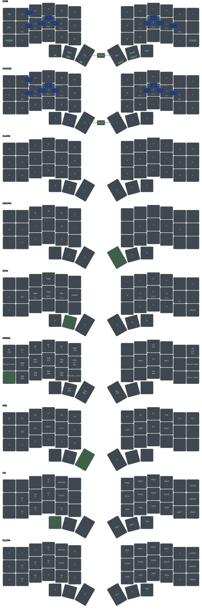

# zmk-config-piantor-pro-bt

ZMK firmware config for the Piantor Pro BT, a 42-key wireless split keyboard. Each half carries its
own nRF52840 on the PCB, with no controller socket. This repo holds the board definition for that
hardware, one keymap, its combos, and the build targets that turn them into a firmware file for each
half.

The behaviors the keymap binds are defined in
[zmk-shared](https://github.com/datapointchris/zmk-shared): home-row mods, thumb layer-taps,
Bluetooth tap-dances and window-manager macros. This repo carries what only a Piantor Pro BT has:
its board definition, its layer order, its combos, its RGB controls and its build matrix.
[zmk](https://github.com/datapointchris/zmk) is the tool that builds, draws, checks and flashes it.

## Install

The firmware compiles inside `zmkfirmware/zmk-build-arm:stable`, the Docker image ZMK's CI workflow
runs. `zmk` drives that container.

```bash
# from your package manager: docker, yq (mikefarah's), python3, uv, fzf, and udisks2 on Linux
curl -fsSL https://raw.githubusercontent.com/datapointchris/zmk/main/install.sh | bash  # zmk, linked into ~/.local/bin
uv tool install keymap-drawer                                              # `keymap`, which renders the SVG
uv tool install keymap-align                                               # column-aligns the keymap
```

## Starting from scratch

`zmk` finds the shared module as a sibling directory named `shared`. The two clones sit side by
side.

```bash
mkdir -p ~/zmk && cd ~/zmk                                                # any parent, as long as both clones share it
git clone https://github.com/datapointchris/zmk-shared shared             # must be named shared, beside the config
git clone https://github.com/datapointchris/zmk-config-piantor-pro-bt piantor  # this name keys the build workspace
cd piantor

zmk check                                           # files, drawing, build targets, shared module, tools
zmk build                                           # fetches the west workspace once, then builds every target
zmk flash piantor_pro_bt_left piantor_pro_bt_right  # one half at a time, each from its bootloader
```

`zmk check` exits 1 on any error. It reports every missing file and tool in one run rather than
stopping at the first.

The first build fetches a west workspace of several gigabytes into `~/.cache/zmk/piantor/`. The
directory is named after the config checkout. Later builds are incremental. An edit to
`config/west.yml` runs `west update` on the next build without being asked. Each firmware lands in
the repo root as `<artifact-name>.uf2`, which git ignores.

`zmk flash` waits for a bootloader drive to appear, checks it for `INFO_UF2.TXT`, then copies the
file. Its prompt says to double-tap reset. On this keymap the bootloader is also a key. Hold SYSTEM
and press the outermost home-row key on the half being flashed: the key that is Esc on the left, or
`'` on the right. That key reboots the half it sits on, whichever hand holds SYSTEM. It exists only
once this keymap is on the board, so a first flash uses the running firmware's own way in. Each half
gets 60 seconds to appear. `ZMK_FLASH_TIMEOUT` changes that.

## Layers — a layer's number is its block's position in the keymap, not its define



| # | Layer | Reached by | Holds |
| --- | --- | --- | --- |
| 0 | BASE | default | QWERTY with home-row mods; Tab and Esc on the left outer column, `\` and `'` on the right; Caps Word on the outer right thumb |
| 1 | COLEMAK | both inner thumbs together, as a toggle | Colemak-DH letters and their home-row mods; every other key falls through to BASE |
| 2 | OS_MAC_LAYER | toggled from SYSTEM's inner right thumb | nothing; every key is transparent, and the layer being on is what marks macOS |
| 3 | DEVLEFT | holding Enter or Space on the inner and middle right thumbs | programming symbols under the left hand; the right home-row mods stay live |
| 4 | NPAD | holding Backspace on the middle left thumb | number pad on the right, with 0 on the middle and outer right thumbs; Home, End, Page Up, Page Down and Insert on the left |
| 5 | SYSTEM | holding the outer key of the bottom letter row, on either side | Bluetooth profiles, USB or BLE output, RGB underglow, media, Ctrl+Alt+Del, bootloader and reset, ZMK Studio unlock, and the macOS toggle |
| 6 | NAV | holding Delete on the inner left thumb | arrows on the right home row, F1–F12 across the top row, plain modifiers on the left |
| 7 | WM | holding the outer left thumb | window-manager chords: focus on the HJKL keys, move on the row above, join on the row below, workspaces on letters |
| 8 | WM_MAC_LAYER | on by itself while WM and OS_MAC_LAYER are both on | WM's chords on Alt instead of Super |

Home-row mods run GASC from the pinky inward: GUI, Alt, Shift, Ctrl, mirrored on the right. On the
letter layers, Shift uses a faster variant than the other three.

SYSTEM's four Bluetooth keys select a profile on a tap and switch output to BLE. A double-tap
disconnects that profile. On SYSTEM, each outer bottom-row key is a reset. Holding one SYSTEM key and
pressing the other reboots the half pressed second.

The combos fire on BASE and COLEMAK alike. They are bound to positions, so they stay on the same
physical keys under either layout. Adjacent home-row pairs type brackets: S+D `[`, D+F `(`, S+F
`{`, then J+K `)`, K+L `]`, J+L `}`. A+S types `_`, L+; types `-`, and Q+W types `~`. Each combo
needs 150 ms of idle before it, so a pair pressed mid-word types both letters.

Keys are numbered row by row across both halves: 0 to 35 for the three letter rows, 36 to 41 for
the thumbs. `KEYS_L`, `KEYS_R`, `THUMBS_L` and `THUMBS_R` at the top of the keymap list them per
hand. They must be defined before `shared_behaviors.dtsi` is included, because every shared hold-tap
names them as its trigger positions.

A layer's number comes from where its block sits in `keymap`. The `#define` at the top only names
that number. A layer inserted anywhere but last leaves every later define pointing at the wrong
block. Nothing errors.

## One firmware per half — the OS is a layer toggled at runtime, and every boot starts on Linux

The keyboard boots with the WM chords on Super, for i3 or sway. SYSTEM's inner right thumb toggles
`OS_MAC_LAYER`. While that is on, holding WM also turns on `WM_MAC_LAYER`, through the conditional
layer at the bottom of the keymap. The same keys then send their chords on Alt, for AeroSpace. The
home-row mods send the same keycodes either way.

The middle right thumb on WM calls `LG(GRAVE)` directly, so it sends GUI and backtick on both.

ZMK keeps layer state in RAM and saves none of it. A reboot, a flash, or waking from the deep sleep
that follows two hours idle all start on Linux again.

Every combo lists `OS_MAC_LAYER` in its `layers`. A combo checks only the highest active layer, and
with the toggle on, that layer is `OS_MAC_LAYER`. A combo added without it stops firing in macOS
mode. The flag sits below DEVLEFT, NPAD, SYSTEM, NAV and WM. A held layer then outranks it, so no
combo fires while one is held, on either system.

`WM_MAC_LAYER` must keep a higher number than both `WM` and `OS_MAC_LAYER`. A layer's keys win only
over layers numbered below it.

## Building — local builds see `../shared` live; CI sees only what is pushed

```bash
zmk sync              # align the keymap, redraw the SVG, build every target
zmk check             # after a keymap edit: does the drawing still match it?
zmk build --pristine  # after a cmake-args change, which the build cache would otherwise keep
zmk --help            # every command
```

`zmk` bind-mounts the sibling `shared/` into the build container. An edit there reaches the next
local build with no commit. CI has no such mount. It resolves zmk-shared through
`config/west.yml`, from GitHub at `main`. A change spanning both repos therefore pushes zmk-shared
first. Otherwise the board's CI run compiles against a `main` that lacks the change. A fork that
changes shared behaviors points the `datapointchris` remote in `config/west.yml` at its own copy.

This config compiles zmk-shared's `main` against ZMK `v0.3`. A shared change that relies on
anything newer than `v0.3` breaks this build.

Every push and pull request builds on GitHub Actions. Each run attaches one `firmware` artifact
holding a `.uf2` per `build.yaml` entry. A fork with no Docker can flash from that.

`config/piantor_pro_bt.keymap` is the one keymap. Its stem names the drawing:
`piantor_pro_bt_keymap.yaml` is the source and `piantor_pro_bt_keymap.svg` the render. The YAML is
written by hand. A keymap edit never reaches the drawing by itself, and the SVG still renders
cleanly. `zmk check` is what notices. It compares every cell by class: a key, transparent, or none.
It also checks that each key opening a layer is labeled with that layer. Other labels are free text,
so it does not compare them. `zmk sync` redraws from the YAML without checking it.

`--pristine` wipes only the build directories. A bad CMake flag persists in their cache until then.
`zmk clean` is the heavier reset. It deletes this repo's whole west workspace, and the next build
fetches it again.

## The board — defined here, because upstream ZMK has no Piantor Pro BT

`config/boards/arm/piantor_pro_bt/` declares an nRF52840 on each half, switches wired straight to
its pins, WS2812 underglow, a MAX17048 battery gauge, and the SPI bus a nice!view plugs into. The
left half is the central. ZMK reads `config/boards/` as a board root, so CI and the local build both
find the board with no flag.

`config/west.yml` pins upstream ZMK at `v0.3`. `.github/workflows/build.yml` calls ZMK's workflow at
the same tag, so the two move together. The pin is there because `main` fails to build this config.
The board definition follows the layout of Zephyr 3.5, which `v0.3` builds on. ZMK's `main` builds
on Zephyr 4.1.

The left half's defconfig turns on ZMK Studio. `build.yaml` also passes `-DCONFIG_ZMK_STUDIO=y` to
that target. Studio runs only on the central. The right half's firmware does not include it. Every
target carries the `studio-rpc-usb-uart` snippet, so Studio reaches the left half over USB as well
as Bluetooth. Studio connects locked and refuses edits until a key unlocks it. To unlock, hold SYSTEM
and press the left half's inner key on the bottom letter row, the key that is B on BASE.

`config/piantor_pro_bt.conf` applies to both halves. There are no side-specific `.conf` files. The
board-level defaults live in the defconfigs under `config/boards/`. The `.conf` sets deep sleep
after two hours idle and raises Bluetooth transmit power to +8 dBm for the link between the halves.
It warns against `CONFIG_ZMK_BLE_EXPERIMENTAL_SEC`, which switches pairing to a passkey and hangs on
Linux.

`config/boards/shields/nice_view_disp/` is a renamed copy of an older ZMK nice!view shield, with an
option to rotate the screen 180 degrees. No `build.yaml` target selects it. Every target builds with
ZMK's stock `nice_view`.

## Settings reset — a firmware that erases a half, for when the halves stop finding each other

```bash
zmk flash piantor_pro_bt_left_settings_reset piantor_pro_bt_right_settings_reset  # erase both halves
zmk flash piantor_pro_bt_left piantor_pro_bt_right                                # then the keymap again
```

A settings-reset firmware deletes every setting its half has stored, Bluetooth bonds included, each
time it boots. It also turns Bluetooth off, so the halves cannot pair until the keymap firmware is
back. Its keys do nothing, so the next flash needs the half's own way into the bootloader.

SYSTEM clears bonds without a reflash. Its top-left key clears the active profile's bond, and its
top-right key clears every profile's.

## The other config repos — they share the module, never the board or the ZMK revision

[zmk-config-corne42](https://github.com/datapointchris/zmk-config-corne42) and
[zmk-config-glove80](https://github.com/datapointchris/zmk-config-glove80) include zmk-shared too.

The Corne42 numbers its keys exactly as this board does. `KEYS_L`, `KEYS_R`, `THUMBS_L` and
`THUMBS_R` hold the same lists in both keymaps. It switches OS at runtime the same way. Its layers
sit at other numbers. It builds a nice!nano, which upstream ZMK defines, on ZMK's `main`.

The Glove80 builds from MoErgo's fork of ZMK. It fixes the OS when its firmware is built, so none of
the runtime switching above applies there.
